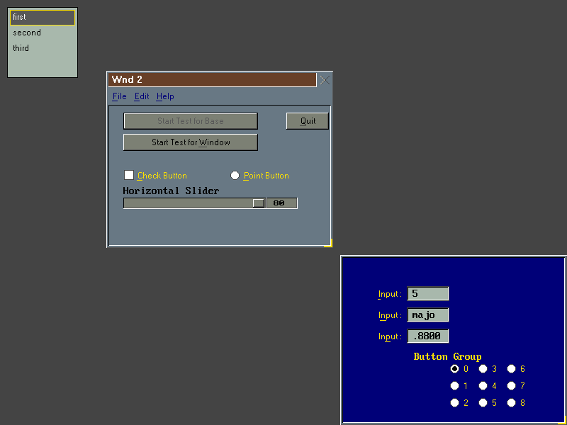
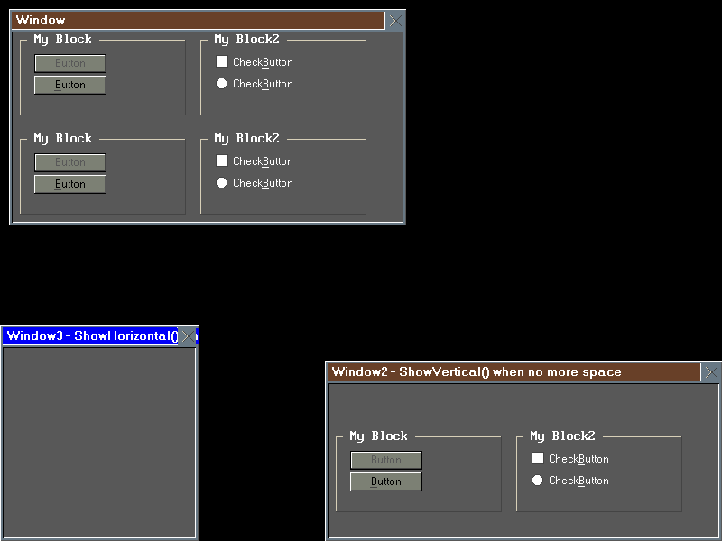
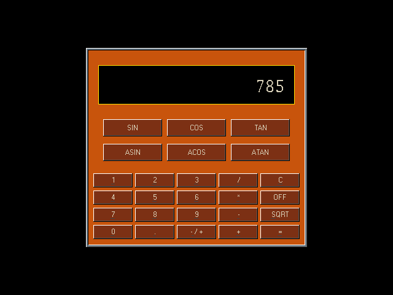
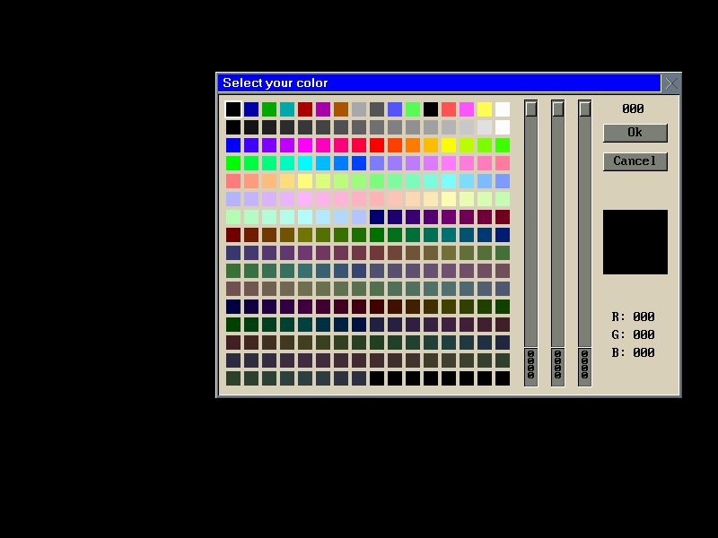
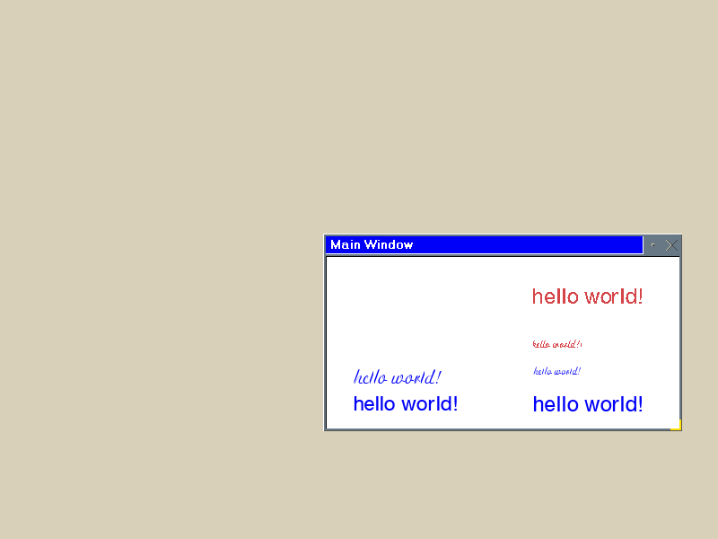
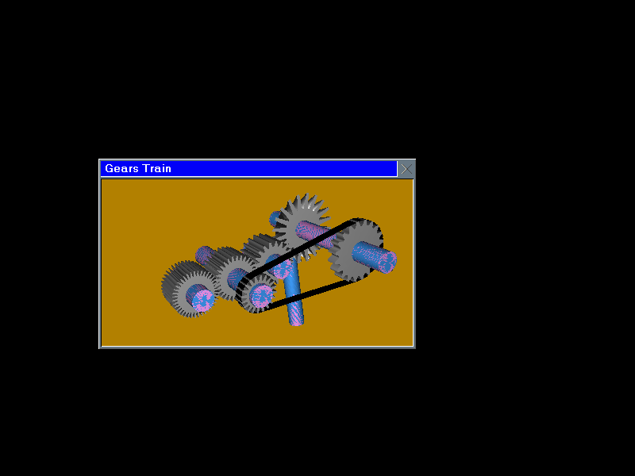
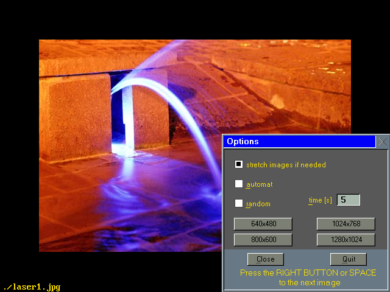
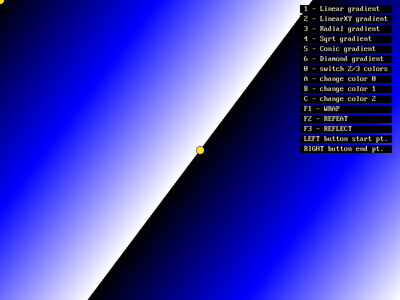

# OpenGUI 5.5.14

OpenGUI (also known as FastGL) is a small, fast C++ GUI toolkit written by
Marian Krivos between 1996 and 2006. It draws everything itself into a frame
buffer: windows, buttons, menus, list boxes, edit fields, file and color
dialogs, bitmaps, fonts and 2D graphics. It needs no other toolkit underneath
it, only a way to put pixels on the screen.

This repository is the original 5.5.14 source, brought up to date so that it
builds and runs on current systems:

| System | Compiler | Notes |
| --- | --- | --- |
| Windows | Visual Studio 2019 (32-bit) | [BUILD-VS2019.txt](BUILD-VS2019.txt) |
| Windows | MSYS2 MinGW-w64 gcc (64-bit) | [BUILD-MSYS2.txt](BUILD-MSYS2.txt) |
| Linux and WSL | gcc (64-bit, X11) | [BUILD-LINUX.txt](BUILD-LINUX.txt) |

One `CMakeLists.txt` builds all three. The library's own code is changed as
little as possible; every change is listed in the build notes above.

## Screenshots

These are the bundled examples, running under WSL.

| | |
| --- | --- |
| <br>Controls: menus, buttons, sliders, edit fields | <br>Windows with panes and groups |
| <br>The calculator example | <br>The color dialog |
| <br>TrueType fonts through FreeType | <br>OpenGL through Mesa's software renderer |
| <br>The JPEG picture viewer | <br>Gradient fills |

## Building

Windows, Visual Studio 2019:

```
cmake -S . -B build -G "Visual Studio 16 2019" -A Win32
cmake --build build --config Release
```

Windows, in an "MSYS2 MINGW64" shell:

```
cmake -S . -B build-msys -G Ninja
cmake --build build-msys
```

Linux or WSL:

```
cmake -S . -B build
cmake --build build -j
```

Each build makes the library for 8-, 16- and 32-bit color in `lib/` and the
35 examples beside their sources in `examples/`. Run an example from its own
folder, as they load their pictures from `../data`:

```
cd examples/calc
./calc
```

On Windows an example takes the whole screen unless it is started with
`-window`. Alt+X leaves an example.

## What is included

- `src`, `include`, `xml`: the library and its XML configuration helper.
- `examples`: 35 small programs, from "hello" to a picture viewer.
- `third_party/freetype`: FreeType 2.13.3, for TrueType fonts.
- `third_party/mesa`: the software renderer of Mesa 7.0.4 with its off-screen
  driver (OSMesa), for the OpenGL examples.
- `doc`: the original documentation.

JPEG and PNG pictures need libjpeg, libpng and zlib. The build compiles them
from the sources that the GraphApp toolkit carries, if it finds them
(`-DGRAPHAPP_DIR=<folder>`); without them the library builds without JPEG
and PNG support.

## What was changed

- A CMake build for Visual Studio 2019, MSYS2 and Linux.
- Windows: mouse and keyboard input work again, and full screen is a
  borderless window at the desktop's own resolution rather than a change of
  display mode (`-oldmode` brings the old behavior back).
- Linux: the window's close button ends the program cleanly.
- 64-bit Windows: the few places that kept a pointer in a `long` are fixed.
- FreeType and Mesa are built in, so the TrueType and OpenGL examples work
  without anything else installed.

## License

OpenGUI is Copyright (C) 1996-2006 Marian Krivos and is distributed under
the GNU Library General Public License; see [COPYING](COPYING). FreeType and
Mesa are under their own licenses, which are in their folders under
`third_party`.

The original home of the library was http://www.tutok.sk/fastgl/.
